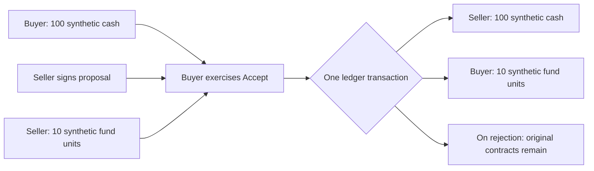

# Canton Settlement Reliability Lab

A local, synthetic fund-for-cash experiment answering: **when a trade fails, do both assets remain unchanged, and what can each participant actually see?**

Seven Daml Script tests and an authenticated live Ledger API harness cover settlement, rejection, rollback, consumed-proposal reuse and visibility. Read [the claim-to-evidence table](EVIDENCE.md) before interpreting the [article](ARTICLE.md). This is an educational model, not a regulated fund or production settlement service.

## Reproduce

Prerequisites: Daml SDK **3.4.11**, its bundled Canton **3.4.11**, Java **17** and Python **3.9+**. The verified machine used OpenJDK 17.0.19 and Python 3.9.6. `daml.yaml` pins the SDK and Daml-LF 2.1. APIs are **Ledger API v2 / JSON API 3.4.11**, Canton protocol 34. These are an installed, verified baseline, not a claim to be the newest release.

If SDK 3.4.11 is absent, obtain it from the [official release](https://github.com/digital-asset/daml/releases/tag/v3.4.11) using its platform-specific installation instructions. Installation on a clean machine was not tested here. The legacy Daml Assistant works with this pin but prints a deprecation warning; a DPM migration is not part of this edition.

For a same-machine check that preserves the original evidence, run from this directory:

```sh
python3 scripts/reproduce-local.py
```

This copies only Daml sources, scripts and `daml.yaml` into a new `.runtime/reproduction-<UTC>` directory, builds and runs Script tests, generates new test credentials, starts a fresh ledger, waits for readiness, runs the live checks and stops that ledger. It checks that ports 17601–17606 are available first. It retains the host's existing SDK, tools and user-level caches. **This is not independent clean-machine reproduction.** Results and command exit codes go to a new `evidence/local-review-<UTC>/` directory; `run.json` records source/DAR fingerprints and outcome. Credentials and raw runtime logs stay in ignored `.runtime/`.

For a manual run, use a separate source copy with an empty `evidence/` directory; do not overwrite the retained baseline:

```sh
mkdir -p evidence
daml version
java -version
python3 --version
daml build > evidence/build.txt 2>&1
daml test > evidence/daml-test.txt 2>&1
bash scripts/start-ledger.sh
```

Stop on any nonzero build/test exit. Wait for `Canton sandbox is ready.` Keep that terminal open. In another terminal in the same source copy:

```sh
python3 scripts/live.py > evidence/live-run.txt 2>&1
python3 scripts/check-evidence.py
```

Stop the ledger with Ctrl-C in its terminal. The ledger is in-memory; a restart removes its state. The harness creates four freshly suffixed parties/users per run. Manual evidence files are overwritten on each run. The live report is invalidated before credentials, DAR loading or network access; an interrupted run lacks `completedUtc` and fails verification. Do not use Python `-O` or `PYTHONOPTIMIZE` for live tests.

Saved evidence can also be reviewed without a running ledger:

```sh
python3 scripts/check-evidence.py --evidence-dir evidence
```

When no local auth config is present, this verifies the evidence and scans for JWT-like values, but explicitly reports the exact local signing-key scan as **SKIPPED**. Absence of detected patterns is not a general secret-audit guarantee. See [the evidence register](EVIDENCE.md) for review findings and independent-machine acceptance criteria.

No Docker, pip packages, Go service, wallet, external network, dashboard or paid service is needed. The test runner and ledger need local socket permission; managed sandboxes may require approval. Ports 17601–17606 must be free. Startup takes time; do not invoke the live harness before readiness. `--dar` is intentionally omitted from startup: the wrapper's upload is unauthenticated, so the harness uploads using the admin user.

The startup script generates a random HMAC key in ignored `.runtime/auth.conf` (mode 0600). This is a test-only authentication setup. All endpoints bind to loopback; do not expose them. The harness signs short-lived user tokens in memory. Admin rights are used only for setup, package upload and creating users. Every holdings/history query uses a user with only `CanActAs` for its own party, which also grants that party's read access. Evidence excludes headers, tokens, keys and contract blobs. The local operator owns the signing key and is trusted.

## Model

| Contract | Signatory | Observers | Explicit choice/controller |
|---|---|---|---|
| Cash | issuer | owner | TransferCash / owner |
| FundUnit | issuer | owner and readers | TransferFund / owner |
| Proposal | seller | buyer | Accept / buyer |

Daml also supplies an Archive choice controlled by signatories. Thus the issuer can issue and archive holdings. This is a trusted synthetic issuer, not a supply-constrained token registry. Owners are observers/controllers rather than signatories: issuance does not require their acceptance, and transfers can give holdings to another party without separate recipient consent. In the exchange, buyer acceptance and seller proposal supply the intended trade consent.

The offered fund is initially readable by the buyer through `readers = [buyer]`; this is deliberate disclosure at issuance. Transfer removes extra readers. The seller commits the fund contract ID and exact terms in a proposal. The buyer supplies its cash ID in Accept. The seller's signatory authority and buyer's controller authority authorize the two nested transfers; the issuer's signature on each holding authorizes creation of its replacement inside that holding's transfer choice.



Accept validates owner, issuer, currency, fund identifier and exact quantities. It exercises the cash transfer, then validates and transfers the fund. A failure on that second leg must roll back the tentative first leg. Holdings and proposal are consumed only on successful settlement. Proposals do not reserve assets; an owner or issuer can invalidate a proposal by consuming a holding elsewhere.

## Tests and reading

```sh
PYTHONDONTWRITEBYTECODE=1 python3 -m unittest discover -s tests -v
python3 scripts/check-evidence.py --evidence-dir evidence
```

The Python suite covers eight configuration protections and six evidence-checker regression cases. The live reproduction command above performs a fresh build, seven Daml Script tests and authenticated API checks. Expected successful output is `evidence/local-review-<UTC>: passed`; inspect `run.json` for command exit codes and `check-evidence.txt` for the actual result. Do not count a skipped key scan as passing.

Read [the beginner tutorial and exercise](ARTICLE.md), [contract model](daml/Settlement.daml), [Script tests](daml/Tests.daml) and [results, provenance and references](EVIDENCE.md).

## Limitations

This is a synthetic educational lab, not a production financial application or independent audit. The issuer can mint/archive holdings; recipients need not consent to direct transfers; proposals do not reserve assets. Exact quantities mean no balance aggregation, change or partial fills. Restarting the in-memory ledger loses its state.

One-participant party filtering does not establish confidentiality against the participant operator or across independent participants. Consumed-proposal rejection with a fresh command ID is not command deduplication or recovery after lost responses. No crash durability, performance, upgrade or cross-network claim follows. Independent clean-machine reproduction and human review remain pending.

Startup accepts only its generated, private, loopback-only authentication configuration. Keep `.runtime` private (0700) and `auth.conf` private (0600). Never publish credentials or raw runtime logs. This test HMAC setup is not production IAM.

AI assisted implementation, drafting and review. Author-confirmed disclosures are in [ARTICLE.md](ARTICLE.md#author-disclosures). Original code and prose use [MIT](LICENSE); third-party material retains its own licence.
